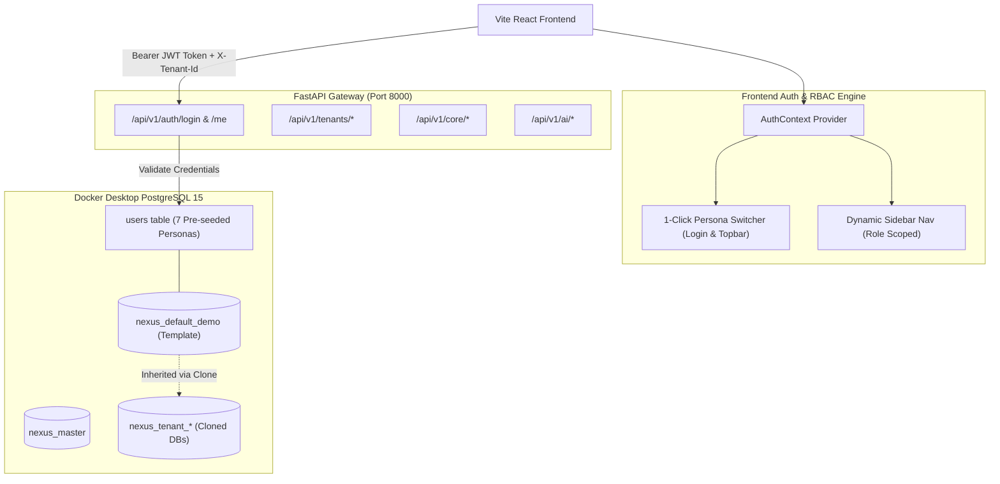

# Multi-Tenant Database, Authentication & RBAC Walkthrough

## Overview
We implemented and verified an enterprise-grade **Multi-Role Authentication**, **JWT Session Management**, and **Dynamic Role-Based Access Control (RBAC)** layer on top of our **Docker PostgreSQL 15** and **Python FastAPI Microservices**.

> [!IMPORTANT]
> **Complete Role Coverage**:
> All 7 key institution personas are now fully functional with individual credentials and 1-click instant login buttons:
> 1. **Student** (`Emma Watson`)
> 2. **Teacher / Faculty** (`Dr. Alan Turing`)
> 3. **HR Manager** (`Sarah Jenkins`)
> 4. **Placement Officer** (`Marcus Vance`)
> 5. **Chief Examiner** (`Prof. Donald Knuth`)
> 6. **Parent / Guardian** (`Arthur Watson`)
> 7. **Super Admin** (`System Administrator`)

---

## 1. Authentication & RBAC Architecture

---

## 2. Verified Visual Proof

### 1-Click Instant Persona Login Screen (`/login`)
The redesigned login screen features the interactive **1-Click Instant Persona Logins** grid alongside traditional institutional credentials:

---

### Student Persona Scoped View (`Emma Watson [STUDENT]`)
Upon logging in as a student, the sidebar automatically filters to student-relevant portals (Academics, Student Life, Career Hub), displays the `ACTIVE SCOPE: Emma Watson (student)` banner, and restricts access to administrative tools:

---

### Chief Examiner Scoped View (`Prof. Donald Knuth [EXAMINER]`)
Switching to the Chief Examiner dynamically re-scopes the session, highlighting Curriculum, Examination Schedules, Gradebook Verification, and Accreditation:

---

### Super Admin Unrestricted View (`System Administrator [ADMIN]`)
Super Admin retains full, unrestricted control across all 64 modules and 6 enterprise portals:

---

## 3. Pre-Configured Demo Credentials

All accounts are pre-seeded in `nexus_default_demo` (and automatically cloned to all new customer databases):

| Persona Title | Name | Login Email | Default Password | Scoped Access |
| :--- | :--- | :--- | :--- | :--- |
| **Super Admin** | System Administrator | `admin@nexuscampus.edu` | `demo123` | **All 64 Modules (Unrestricted)** |
| **Student** | Emma Watson | `student@nexuscampus.edu` | `demo123` | LMS, Courses, Attendance, Timetable, Wellbeing, Placement |
| **Teacher / Faculty** | Dr. Alan Turing | `teacher@nexuscampus.edu` | `demo123` | Gradebook, Attendance Marking, Course Builder, Studio, Quizzes |
| **HR Manager** | Sarah Jenkins | `hr@nexuscampus.edu` | `demo123` | Staff Directory, Payroll, Tenancy Setup, Accreditation |
| **Placement Officer** | Marcus Vance | `placement@nexuscampus.edu` | `demo123` | Placement Hub, Drives, Student Profiles, Career Analytics |
| **Chief Examiner** | Prof. Donald Knuth | `examiner@nexuscampus.edu` | `demo123` | Examination Board, Grade Normalization, Timetable |
| **Parent / Guardian** | Arthur Watson | `parent@nexuscampus.edu` | `demo123` | Parent Portal, Student Wellbeing, Fee Invoices |

---

## 4. End-to-End Test Video
Browser recording demonstrating the live login flow, 1-click persona switcher, and dynamic sidebar filtering:
- Video recording: `verify_multi_role_auth_1789381052548.webp`
